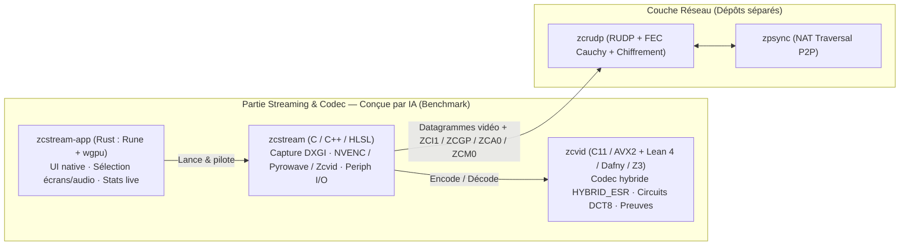

# zcstream-app — Streaming Vidéo & Codec Temps Réel

[](https://github.com/i-Charlys/zcstream-app/actions/workflows/ci.yml)
[](https://github.com/i-Charlys/zcstream-app/actions/workflows/release.yml)
[](LICENSE)

Interface graphique native accélérée GPU (`Rune` + `wgpu`) pour le **streaming vidéo ultra-basse latence** avec capture/contrôle complet des périphériques (façon Parsec / Moonlight), en UDP direct ou en pair-à-pair via ZPSync NAT Traversal.

> [!NOTE]
> **Projet conçu par IA — Un benchmark d'ingénierie de bout en bout**
>
> Toute la partie **streaming et codec** de cet écosystème ([`zcstream-app`](https://github.com/i-Charlys/zcstream-app), [`zcstream`](https://github.com/i-Charlys/zcstream) et [`zcvid`](https://github.com/i-Charlys/zcvid)) est **conçue, écrite, optimisée et vérifiée formellement par IA**.
>
> Ce projet sert de **benchmark concret et reproductible** pour évaluer jusqu'où une IA peut aller sur un système complexe complet sans raccourci :
> - **Interface GPU native** en Rust (`Rune` + `wgpu`) sans navigateur embarqué ni Electron.
> - **Pipelines temps réel** : DXGI Desktop Duplication, shaders compute HLSL (`cs_5_0`), NVENC H.264, Pyrowave Vulkan Wavelets, Winsock RIO et entrée/sortie périphériques bidirectionnelle.
> - **Codec vidéo & circuits algébriques maison** (`zcvid` en C11/AVX2) : circuits DCT8 12-mul, codeur hybride `HYBRID_ESR` à **701 FPS en 1080p**, mais aussi exploration de recherche avancée (Galois-116 2D cyclotomique, semiring tropical-simplicial à parallélisme spéculatif).
> - **Preuves formelles vérifiées par machine** : **5 fichiers Lean 4** purs (0 `sorry`, 0 axiome personnalisé), **Dafny**, **Z3** et **TLA+** (`ZcTransport.tla`).
> - **Transparence scientifique totale** : les échecs et limites mesurés sur matériel réel (ex. Galois-116 plus lent sur AVX2 que le séparable, parallélisme spéculatif battu par le séquentiel sur blocs légers, ou NVENC H.264 encore devant sur panoramiques sous-pixels) sont publiés sans filtre dans les README techniques.
>
> *La couche réseau (`zcrudp`) et la traversée NAT (`zpsync`) sont des dépôts compagnons séparés.*

---

## Architecture (Streaming & Codec vs Couche Réseau)



---

## Fonctionnalités principales

- **Multi-pipelines vidéo ultra-basse latence** :
  - **Zcvid HLSL/CPU** : codec différentiel à intégrateur à fuite + blocs transformés + codeur par intervalles adaptatif (`0 px` de dérive en boucle fermée).
  - **NVENC Direct (`H.264`)** & **Pyrowave (`Vulkan Wavelets`)** sur matériel compatible.
- **Entrée / Sortie périphériques complète (façon Parsec / Moonlight)** :
  - **Clavier & Souris** (`ZCI1`, `20 B`) : scancodes AT Set 1, souris absolue/relative, boutons et molette H/V (`--input` / `--no-input`).
  - **Manettes** (`ZCGP`, `24 B`) : jusqu'à `4` manettes XInput (`--gamepad` / `--no-gamepad`).
  - **Audio système hôte → client** (`ZCA0`, `48 kHz` / `10 ms` IMA-ADPCM) : boucle audio complète (`--audio`, `--audio-out <dev>`).
  - **Micro client → hôte** (`ZCM0`, `48 kHz` / `10 ms` IMA-ADPCM) : retour micro optionnel (`--mic`, `--audio-in <dev>`).
  - **Sélection des périphériques** (`--list-devices`) : choix de l'écran et des périphériques audio directement depuis l'interface ou la ligne de commande.
- **Réseau résilient** : FEC Cauchy $\mathrm{GF}(2^8)$ adaptatif, retransmissions sélectives `ZCNK`, resynchronisation `ZCSY` et connexion P2P sans redirection de port via ZPSync.

---

## Résultats clés du benchmark IA

*Mesures vérifiées directement dans les bancs d'essai (détails complets dans [`zcstream`](https://github.com/i-Charlys/zcstream) et [`zcvid`](https://github.com/i-Charlys/zcvid)) :*

| Volet évalué | Résultat mesuré | Statut |
| :--- | :--- | :--- |
| **Streaming 1080p @ 120 fps (loopback, TITAN RTX)** | NVENC Direct : `3.33 ms` p50 · Pyrowave RIO : `1.33 ms` p50 · Zcvid HLSL : `0.83–1.31 ms` (`0 px` mismatch) | Production |
| **Circuit IDCT8 AVX2 / Sparse vs Ref 1024-MAC** | 12-mul AVX2 : `19.6 ns` (`7.3x`) · LL 4×4 CSBF : `10.9 ns` (`13.2x`) · Poly 3×3 deg-2 : `9.5 ns` (`15.1x`) | Production (`0` mismatch) |
| **Codec `HYBRID_ESR` vs baseline `TQ4`** | **`-56.60%` BD-Rate** (`+11.93 dB` BD-PSNR) sur 5 scènes ; **`701 FPS` en 1080p** sur 16T (`1.426 ms` enc / `0.318 ms` dec) | Production (`0` mismatch) |
| **Vérification formelle** | **22 preuves C11**, **5 modules Lean 4** purs (0 `sorry`, 0 axiome custom), **Dafny**, **Z3**, **TLA+** (`7.9M` états) | CI verte (`5/5` jobs) |
| **Recherche : Galois-116 2D DCT8** | `-39.6%` de multiplications (`116` vs `192`), prouvé exact en Lean 4, mais `47.89 ns` AVX2 vs `22.30 ns` séparable | Conservé en module recherche |
| **Recherche : Tropical-Simplicial spéculatif** | Confluence bit-exacte prouvée (`0` mismatch), mais `0.518 ms` (8T) vs `0.177 ms` (séquentiel) sur blocs légers | Conservé en module recherche |

---

## Téléchargement direct (Releases GitHub)

Téléchargez l'archive précompilée pour votre plateforme depuis **[GitHub Releases](https://github.com/i-Charlys/zcstream-app/releases)** (`windows-x64`, `windows-arm64`, `linux-x64`, `linux-arm64`), décompressez-la et lancez directement `zcstream-app`. Aucune compilation ni configuration manuelle requise.

## Compilation depuis les sources (1 commande)

Vous n'avez **pas** besoin de cloner les 5 dépôts manuellement ni de modifier des chemins d'accès :

### Windows (PowerShell)
```powershell
git clone https://github.com/i-Charlys/zcstream-app.git
cd zcstream-app
powershell -ExecutionPolicy Bypass -File .\install.ps1
```

### Linux / macOS
```bash
git clone https://github.com/i-Charlys/zcstream-app.git
cd zcstream-app
chmod +x ./install.sh
./install.sh
```

L'installeur récupère automatiquement les dépôts compagnons (`zcrudp`, `zcvid`, `zpsync`, `zcstream`), compile les binaires en `Release` et assemble un bundle autonome dans `../dist/`.

## Surcharges d'environnement (optionnelles)

`zcstream-app` découvre automatiquement les exécutables (`zcrudp_stream`, `zpsync_peer`) à côté de l'exécutable, dans `../dist/`, dans `../zcstream/build/{,Release,Debug}`, ou via le `PATH` :
- `ZCSTREAM_BIN_DIR` : dossier contenant les binaires `zcstream`.
- `ZCSTREAM_ROOT` : dossier racine contenant les dépôts compagnons.

## Licence & Citations

Ce projet et l'ensemble des dépôts de la suite (`zcstream-app`, `zcstream`, `zcvid`, `zcrudp`, `zpsync`) sont distribués sous licence **MIT** — voir [LICENSE](LICENSE).

Les attributions aux bibliothèques tierces (`Rune`, `wgpu`, `winit`, FFmpeg `nv-codec-headers`, `Pyrowave`) ainsi que les références scientifiques et standards (RFC 8439, RFC 7748, RFC 8298, Cauchy FEC, H.264/HEVC, Jayant ADM, STUN/DHT) sont détaillées dans [THIRD_PARTY_NOTICES.md](THIRD_PARTY_NOTICES.md).
